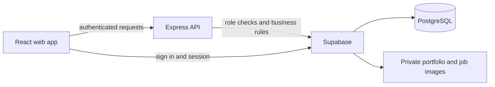

# KaamPass

KaamPass helps workers and employers agree on work and build a record of verified jobs. The app supports English, Roman Urdu and Urdu.

## Problem statement

Informal workers often rely on verbal agreements, word-of-mouth referrals and chat history to show their experience. A worker who changes neighbourhoods or meets a new employer may need to rebuild trust from the beginning.

KaamPass gives electricians, plumbers and painters a portable professional profile and turns mutually confirmed work into a record they can choose to share. It is built for workers and employers in Pakistan who need a simple, multilingual way to agree on work and preserve its history.

## Solution and main features

- Worker and employer accounts with separate actions and permissions.
- Profession-specific worker profiles for electricians, plumbers and painters.
- Employer job requests with optional problem images.
- Profession-matched job browsing, worker bids and employer bid selection.
- Clear agreements, worker acceptance or rejection, completion and worker confirmation.
- Verified work history, optional employer feedback and repeat-work statistics.
- Worker-controlled public profiles, selected public work summaries, portfolio sharing and a QR link.
- English, Roman Urdu and Urdu interfaces, including right-to-left Urdu layout.

Verification in KaamPass means that the employer and worker complete the platform workflow. It is not independent identity, skills or payment verification.

## Technology stack

| Area                    | Technology                                            |
| ----------------------- | ----------------------------------------------------- |
| Web app                 | React, TypeScript, Vite, i18next and QRCode React     |
| API                     | Express, TypeScript, Zod and Multer                   |
| Data and authentication | Supabase Auth, PostgreSQL, Storage and SQL migrations |
| Quality checks          | ESLint, Prettier, TypeScript and Vitest               |

## Architecture



The browser owns presentation and session handling. The API validates input, enforces roles and runs job and agreement transitions. Supabase stores accounts, profiles, jobs, agreements, verified records and private files.

## Requirements

- Node.js 22.11 or later in the Node 22 series, and npm 10.9 or later
- Docker Desktop running
- A terminal opened in the project root

## Run locally

1. Install packages: `npm install`.
2. Start the local database and authentication service: `npm run supabase:start`. The first start downloads Docker images. Wait until the health checks finish.
3. Create your own environment files. In PowerShell:

   ```powershell
   Copy-Item apps/web/.env.example apps/web/.env.local
   Copy-Item apps/api/.env.example apps/api/.env
   ```

4. Run `npm run supabase:status` and use the values it prints to edit the files:

   | File                  | Variable                    | Local value                            |
   | --------------------- | --------------------------- | -------------------------------------- |
   | `apps/web/.env.local` | `VITE_API_URL`              | `http://localhost:3001`                |
   | `apps/web/.env.local` | `VITE_SUPABASE_URL`         | Project URL from the status output     |
   | `apps/web/.env.local` | `VITE_SUPABASE_ANON_KEY`    | Publishable key, or legacy anon key    |
   | `apps/api/.env`       | `SUPABASE_URL`              | The same Project URL                   |
   | `apps/api/.env`       | `SUPABASE_SERVICE_ROLE_KEY` | Secret key, or legacy service role key |
   | `apps/api/.env`       | `PORT`                      | `3001`                                 |
   | `apps/api/.env`       | `WEB_ORIGIN`                | `http://localhost:5173`                |
   | `apps/api/.env`       | `NODE_ENV`                  | `development`                          |

   The variable names remain `ANON_KEY` and `SERVICE_ROLE_KEY` even when the CLI calls the values Publishable and Secret. Never put the secret key in the web file or commit environment files. If both `.env` and `.env.local` exist in the web folder, Vite gives `.env.local` priority. Restart the app after changing environment files.

5. Run `npm run dev` and open the web address printed by Vite, normally `http://localhost:5173`. The API normally runs on port 3001. Keep the terminal open.

Local Supabase Studio is normally at `http://127.0.0.1:54323`. Use `npm run supabase:stop` when finished. Local Supabase services and demo credentials are for development only; do not use them in production or expose them to an untrusted network.

## Demo accounts

The local seed provides these fictional accounts. Their shared development-only password is `KaamPassDemo123!`.

| Account         | Email                 | Role                      |
| --------------- | --------------------- | ------------------------- |
| Ahmed           | `ahmed@example.test`  | Electrician in Lahore     |
| Bilal           | `bilal@example.test`  | Plumber in Rawalpindi     |
| Sana            | `sana@example.test`   | Painter in Islamabad      |
| Ali Raza        | `ali@example.test`    | Household employer        |
| Farah Khan      | `farah@example.test`  | Electrician in Lahore     |
| Usman Tariq     | `usman@example.test`  | Electrician in Rawalpindi |
| Ayesha Malik    | `ayesha@example.test` | Plumber in Islamabad      |
| Hamza Iqbal     | `hamza@example.test`  | Plumber in Lahore         |
| Mariam Noor     | `mariam@example.test` | Painter in Rawalpindi     |
| Zain Abbas      | `zain@example.test`   | Painter in Islamabad      |
| Nida Homes      | `nida@example.test`   | Household employer        |
| Kamran Builders | `kamran@example.test` | Construction business     |
| Hira Boutique   | `hira@example.test`   | Shop employer             |
| Saad Workshop   | `saad@example.test`   | Workshop employer         |

After `npm run db:reset`, the fictional seed provides 14 accounts, 15 open job requests, 15 matching bids, nine verified jobs and nine fictional feedback entries. This makes profiles, job matching, agreements, history and feedback useful as soon as the app starts. The seed is idempotent: running it again does not duplicate its fixed demo records.

For the main demo:

1. Sign in as Ali and post an electrician job. Sign out.
2. Sign in as Ahmed, find the matching job and submit a bid. Sign out.
3. Sign in as Ali, choose Ahmed's bid and review the agreement. Sign out.
4. Sign in as Ahmed and accept the agreement. Sign out.
5. Sign in as Ali, mark the work complete and enter the actual days and amount paid. Sign out.
6. Sign in as Ahmed and confirm the work and payment. The verified work appears in his work history. He can choose whether to publish his public profile.

Bilal and Sana can be used to demonstrate matching jobs for their professions. Demo records created during a rehearsal remain until you reset the local database.

## Migrations and reset

- `npx supabase migration up --local` applies pending migrations without intentionally deleting existing data.
- `npm run db:lint` checks the local database schema.
- `npm run db:reset` **deletes the local database data**, reapplies migrations and loads `supabase/seed.sql`. Use it only when you want a fresh local demo. Back up any data you need first.

The seed is configured in `supabase/config.toml`; it inserts missing demo records without overwriting existing accounts or profiles. Running the seed again is not a reset and does not remove jobs or restore edited profiles. Never load the demo seed into a hosted project.

## Checks and contributions

Run `npm run check` for formatting, lint, type checks, tests and production builds. The default run skips database integration tests; they require a separately configured local test instance on port 55321. A passing default run does not verify the complete demo or a deployment.

Please keep changes focused and readable, run the relevant checks, and describe how you tested your contribution. See [the strategy](docs/strategy.md) for planned work and current status.

## Demonstration

Use the six-step demo above to show the full employer-to-worker workflow. For a judge-facing presentation, show the worker profile first, then one job request, bid, agreement, confirmation and the resulting verified history. Finish by opening the public profile and QR link after deployment.

The local prototype has been rehearsed in the browser. A hosted link, screenshots or a short recorded demo should be added before submission so judges can assess it without setting up Docker.

## Team contributions

Abdullah Mehmood is the project creator and sole contributor. He is responsible for the product direction, implementation, documentation and demo preparation.

## Submission readiness

- [x] Clear project description, problem statement, solution, stack, architecture, setup and test instructions.
- [x] Recognized MIT licence, copyright Abdullah Mehmood.
- [x] Major frameworks and services acknowledged.
- [x] Local functional prototype and repeatable fictional demo data.
- [x] Public GitHub repository: [Abdullahxbytes/KaamPass](https://github.com/Abdullahxbytes/KaamPass).
- [x] Sole-contributor record.
- [ ] Hosted demo URL or recorded demonstration.
- [ ] Final review that no environment files, API keys or private data are committed.

See [hackathon readiness](docs/hackathon-readiness.md) for an evidence-based draft score against the official criteria.

## Acknowledgements and licence

Built with React, Vite, Express, Supabase and other open-source packages listed in the workspace package files. KaamPass is available under the [MIT licence](LICENSE), copyright Abdullah Mehmood.
