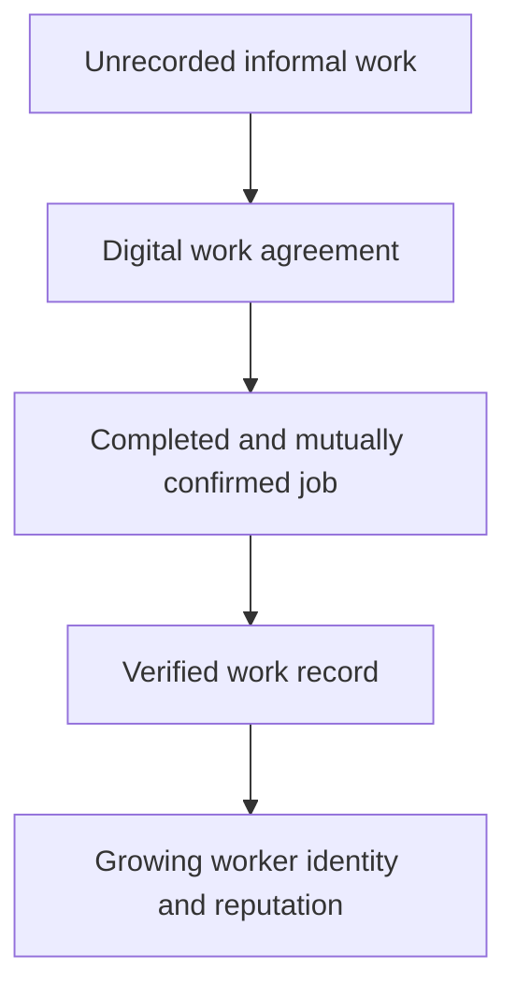
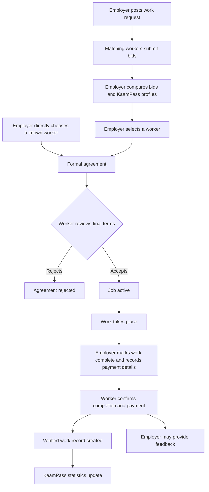

# KaamPass

**A portable digital work identity and verified employment-history platform for informal workers.**

## Problem and purpose

Informal work often depends on verbal agreements, cash payments, WhatsApp conversations, personal references, temporary contractors, and word-of-mouth hiring. Workers may have years of experience but no formal employment history, salary slips, verified experience, portable reputation, proof of completed jobs or skills, structured income records, or digital agreements. Moving to another city or meeting a new employer can mean rebuilding trust from zero.

KaamPass turns this work into structured, mutually confirmed records. Its main product asset is a continuously growing, worker-owned professional work history. The worker's KaamPass represents actual recorded work rather than only a self-written profile.

The hackathon prototype must prove this hypothesis: **informal work can be converted into a trusted, portable and verifiable employment history using a simple digital workflow.** Here, “verified” means confirmed through the platform's worker/employer workflow; it does not mean independent identity, skill, or payment verification.

## Target users and MVP professions

The MVP supports **only electricians, plumbers, and painters**. Three detailed, realistic professions provide a stronger demonstration than many generic, incomplete profiles. The architecture should allow future professions without introducing them into this hackathon.

| Perspective | Purpose |
| --- | --- |
| Worker | Create and edit a professional profile, add skills and portfolio images, receive and accept/reject agreements, perform jobs, confirm completion/payment, and build work history. |
| Employer | A household, contractor, small business, shop owner, workshop, or construction business that posts work requests, reviews bids and worker profiles, creates agreements, manages jobs, confirms completion and payment details, and leaves feedback. |
| Public verifier | Open a public KaamPass without an account to inspect its professional profile and selected verified history. |

Future verifiers could include employers, contractors, businesses, banks, NGOs, training organizations, insurers, and government programs. No institutional integration is required for the MVP.

## Rich, profession-specific profiles

Profiles include experience, service area, skills, availability, typical pricing, portfolio images, verified jobs, verified work days, repeat employers, and feedback. Profession-specific details give employers useful context beyond a name, trade, and phone number.

| Profession | Skill examples | Specialized profile details |
| --- | --- | --- |
| Electrician | Residential/commercial wiring, DB installation, fault diagnosis, appliance installation, solar installation, maintenance, switch/socket installation, safety-related experience | Tools owned, emergency-service availability, relevant safety experience |
| Plumber | Pipe fitting, leakage repair, bathroom installation, drainage work, water tank installation, geyser installation, water pump work, fixture installation, maintenance, emergency services | Tools, material familiarity, emergency-service availability |
| Painter | Interior/exterior painting, wall preparation, wall putty, texture work, wood polish, spray painting, finishing, repainting, surface preparation | Preferred paint types and area-based work experience |

These are profile vocabulary examples, not mandatory claims about every worker. Self-declared skills must be distinguishable from any future verified skills or certifications.

### Portfolio

Workers can show selected work images using Supabase Storage. Electricians can show panels, wiring, solar installations, and DB installations; plumbers can show bathrooms, pipework, water tanks, and finished fixtures; painters can show before/after walls, interiors, exteriors, textures, and finishes. Portfolio images are evidence of presented work, not automatic verification. Images should avoid exposing private customer details.

### Illustrative profiles and agreements

The following are fictional demo data, not real workers or market-price claims:

| Worker | Profile example | Agreement example |
| --- | --- | --- |
| Ahmed — Electrician | Lahore; 5 years' experience; wiring, DB installation, fault diagnosis; owns tester and drill; available weekdays; panel/wiring portfolio | DB installation; 2 days; labour Rs 8,000; materials supplied by employer |
| Bilal — Plumber | Rawalpindi; 7 years' experience; bathroom installation, leakage repair, pipe fitting; PVC/PPR familiarity; owns pipe tools; available weekends; bathroom/fixture portfolio | Bathroom plumbing; 3 days; labour Rs 12,000; worker purchases materials |
| Sana — Painter | Islamabad; 4 years' experience; interior painting, putty, finishing; emulsion paints; apartment-area experience; available next week; before/after portfolio | Interior painting; 1,500 sq ft; 2 coats; labour Rs 25,000; paint supplied by employer |

Each profile also supports typical pricing and work-history statistics. Those statistics must come from confirmed records, not invented profile claims. The MVP need not support every possible trade-specific agreement field, but its data model should allow these differences.

## The KaamPass and dashboard

A public KaamPass shows the worker's name, profession, location/service area, experience, skills, verified jobs, verified work days, repeat employers, selected portfolio, availability, public feedback, and a unique QR code. The QR links to the public verification page; an employer can locate the worker there and start an agreement after authentication.

The private worker dashboard communicates verified jobs, verified work days, recorded earnings, repeat employers, skills, current jobs, and pending agreements. Ratings are supplementary. Completed jobs, verified work days, repeat employers, and evidence-backed skills should carry more weight than subjective ratings alone.

Phone numbers, detailed earnings, private work agreements, and private addresses are private by default and must not appear publicly without appropriate permission. Public history uses a limited, deliberately selected view. Recorded earnings reflect confirmed payment information; KaamPass does not transfer money or independently verify cash settlement.

## Job discovery and core work agreement loop

An employer may post a problem for relevant workers to bid on or send a direct offer to a worker they already know. A job post contains the profession, broad service area, description, optional problem images, preferred timing, material responsibility, and profession-specific details. Matching workers may submit one price, estimated duration, and short message. Selecting a bid creates the formal agreement; it does not skip mutual confirmation.

The agreement captures the selected worker, work, duration, agreed labour cost or rate, material responsibilities, and relevant profession-specific details. Both parties must understand what they are confirming. Exact addresses and contact details remain private before selection.

Optional feedback is not a prerequisite for a verified record. If the worker has not confirmed completion/payment, the agreement must not silently become a verified job. Resolving disagreement at scale is outside this MVP.

### Worker workflow

Register → choose preferred language → select Worker role → choose Electrician, Plumber, or Painter → complete professional profile → add skills and portfolio → receive KaamPass QR → review matching work requests → submit one bid → review selected agreement → accept or reject → perform accepted job → review employer completion/payment details → confirm → see the verified record and updated KaamPass.

### Employer workflow

Register → select Employer role and maintain employer profile → post a work request with optional problem images or directly choose a known worker → review matching bids and KaamPass profiles → select a worker and send the formal agreement → wait for acceptance → manage active job → mark work complete and record agreed payment → obtain worker confirmation → optionally provide feedback → see the verified record added.

### Public verification workflow

Scan QR or open link → view public profile → inspect trade, skills, verified jobs, verified work days, portfolio, and selected records → confirm that the KaamPass exists and inspect its recorded history. No account is required for public viewing; this is not CNIC or government verification.

## Multilingual accessibility

English, Roman Urdu, and Urdu are core interface requirements. Store the selected language in the user's profile and restore it at the next login. English and Roman Urdu use LTR layouts; Urdu uses RTL. Translate the full core workflow, including forms, errors, statuses, and confirmation messages, so users can understand their agreements. Interface translation does not imply automatic translation of user-written content.

## MVP functionality and boundaries

The 40-hour hackathon includes authentication; worker and employer roles/profiles; all three interface languages and saved preference; Urdu RTL; editable profession-specific worker profiles and skills; portfolio images; employer work requests with limited optional problem images; profession-matched worker bids; bid selection; direct agreements and accept/reject; active jobs; employer completion confirmation; worker completion/payment confirmation; verified work history; worker statistics; optional feedback/ratings; and public verification.

Do not implement bank integrations, actual payments, loans, insurance integration, government integration, pension or social-security integration, CNIC verification, blockchain, marketplace payments, bid boosting, paid proposals, complex messaging, escrow, complex payroll, AI-based skill verification, large-scale dispute resolution, or additional professions. These are roadmap topics only.

## Live demo: Ahmed's first verified job

Start Ahmed's electrician profile with **0 verified jobs, 0 verified work days, and Rs 0 recorded work income**. An employer opens his KaamPass and creates an electrical-installation agreement for **3 days at Rs 2,000/day, totalling Rs 6,000**.

Ahmed accepts. After the work, the employer marks it completed and records payment details. Ahmed confirms completion/payment. His dashboard then shows **1 verified job, 3 verified work days, and Rs 6,000 recorded work income**, with the new job in his history. Public verification shows the permitted work-history details; earnings stay private by default.

Include separate realistic plumber and painter profiles to demonstrate profession-aware behavior. The live demo succeeds when agreement, mutual confirmation, record creation, updated statistics, and public verification form one clear working flow.

## Product distinction and long-term vision

KaamPass is not merely a job board, freelancer marketplace, worker directory, or rating website. Discovery supports its core purpose: each completed and mutually confirmed job strengthens a portable professional identity that the worker can carry to future employers.

The future direction is digital worker identity → verified history → skills/certifications → portable reputation → income history → job matching → digital contracts → payments/payroll → training → insurance → microfinance/credit support → pensions/social security → government/NGO integrations. These are possibilities, not delivered features or promises of eligibility.

Later professions may include carpenters, mechanics, AC technicians, welders, construction workers, drivers, domestic workers, and other informal workers. The hackathon remains limited to the original three.

Prioritize the core workflow, realistic profiles, reliable functionality, established libraries, multilingual accessibility, privacy, and a clear demo. Do not add AI for marketing or introduce blockchain. The public GitHub project should eventually include a README, setup instructions, dependency acknowledgements, and contribution information. This documentation-only phase supplies the product direction, architecture, and a root MIT license. It describes the intended MVP, not an already implemented application.
