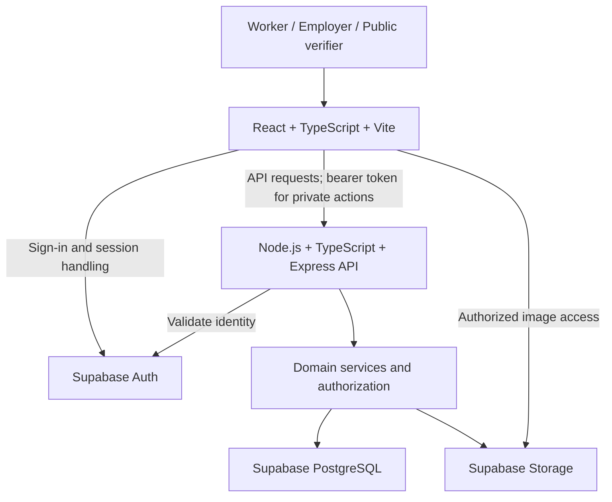

# KaamPass technical direction

This document defines the agreed architecture for a 40-hour hackathon MVP. It is a design specification, not a statement that the application exists. The only supported worker professions are electricians, plumbers, and painters.

## Agreed stack

| Area | Technology | Responsibility |
| --- | --- | --- |
| Frontend | React, TypeScript, Vite | Standalone browser application and typed UI; React with Vite, not Next.js |
| Styling/components | Tailwind CSS, shadcn/ui | Responsive forms, dashboards, profiles, and accessible interaction components |
| Internationalization | react-i18next | English, Roman Urdu, Urdu, and interface translation |
| API | Node.js, TypeScript, Express.js | Authentication checks, authorization, validation, workflow rules, and public/private responses |
| Data platform | Supabase PostgreSQL | Relational application data and transactional persistence |
| Authentication | Supabase Auth | Registration, login, and sessions |
| Media | Supabase Storage | Worker profile and portfolio images |
| Validation | Zod | Forms, request validation, and shared schemas where appropriate |
| QR | Maintained generation/scanning packages, selected during implementation | Generate public-profile links and scan them without building custom QR infrastructure |

Exact dependency versions, QR libraries, hosting, and authentication sign-in method remain implementation decisions. No additional framework or service is required by this document.

## High-level architecture



Supabase saves hackathon time by supplying authentication, storage, and a real PostgreSQL database. Express remains the main business-logic layer so state transitions, record generation, statistics, authorization, and private-data protection have one controlled path. React handles presentation and interaction; frontend checks do not replace server enforcement. Supabase client access must not let a browser bypass the workflow.

## Suggested logical layers

| Layer | Responsibilities |
| --- | --- |
| Presentation | Role-specific screens, profile editing, agreements, dashboards, QR display/scanning, localization, RTL, loading/error states |
| Frontend API/session adapter | Attach sessions to API requests, handle expiration and API errors, map validated responses to UI |
| Express routes and middleware | Token verification, role/ownership checks, Zod request validation, bounded requests, consistent errors |
| Domain services | Agreement creation/acceptance/rejection, allowed transitions, completion/payment confirmation, verified record generation, feedback eligibility, statistics |
| Persistence repositories | Relational queries, transactional writes, constraints, public-profile projections |
| Platform adapters | Supabase Auth and Storage interactions, permitted media access |
| Shared contracts | Stable API types, language/profession values, suitable Zod schemas; no server secrets |

These are logical boundaries, not a requirement for microservices or a large directory tree. One frontend and one modular Express backend are sufficient.

## Authentication and authorization

Supabase Auth handles registration, login, and session lifecycle. Store application role and language preference in the associated application profile. The frontend sends the session access token for protected API requests; Express verifies it through supported Supabase authentication mechanisms and derives identity from the verified token.

Workers may change their own profiles and respond to their own agreements. Employers may create and manage agreements in which they are the employer. The API must check ownership as well as role on every protected resource; submitted user IDs and hidden UI controls are not authorization. Public verifiers only receive explicitly public profile data and need no account.

Whether one account can hold both roles is not settled by the brief; keep role handling explicit and decide before implementing onboarding. Do not assume users can grant themselves privileged permissions.

## Suggested relational entities

Entity names are conceptual and may be refined without changing the product direction.

| Entity | Suggested content and relationships |
| --- | --- |
| `users` | Supabase Auth identity reference, application role, preferred language (`en`, `ur-roman`, `ur`) |
| `worker_profiles` | User reference, public identifier, profession, name, service area, experience, availability, pricing, profession-specific profile details |
| `employer_profiles` | User reference, employer name/type and permitted contact details |
| `skills` | Profession-scoped skill vocabulary |
| `worker_skills` | Worker/skill relationship; distinguish self-declared skills from future evidence-backed assertions |
| `portfolio_items` | Worker ownership, storage object reference, caption, display order, visibility |
| `job_posts` | Employer-owned work request, profession, broad service area, description, timing, materials, status, and trade details |
| `job_post_images` | Private problem-image storage references with a strict count, type, and size limit |
| `job_bids` | One worker proposal per job post with pricing model, amount, estimated days, message, and selection state |
| `work_agreements` | Worker/employer references, work description, duration, labour amount/rate, material responsibilities, status, trade-specific details, timestamps |
| `jobs` | Accepted agreement reference, active/completion state, each party's confirmation and payment declaration |
| `work_records` | Unique completed-job reference, confirmed work facts, work days, recorded income, verification timestamp, public-safe details |
| `feedback` | Eligible completed-job reference, employer author, worker recipient, rating/comment and public visibility |

Use foreign keys and uniqueness constraints to preserve relationships. Represent money with a precise numeric type or integer minor units and an explicit currency; do not use floating-point arithmetic for totals. Store timestamps consistently. Define the meaning of work days before implementation; the demo uses three agreed and confirmed days, not elapsed calendar time inferred from clicks.

Keep common fields relational. Validated profession-specific structured fields can hold tool/material preferences, painting area/coats, and other trade details. The server must validate them against the selected profession. A future profession registry can extend this model, while the MVP allowlist remains exactly three professions.

## Workflow rules and consistency

Suggested states are pending agreement → accepted or rejected; accepted agreement → active job → awaiting worker confirmation → verified completion. These are proposed implementation names, not an additional product requirement.

1. Only an employer with a completed profile creates a work request. Problem images stay private and use short-lived access URLs.
2. Only workers whose saved profession matches the request may view it and submit one bid.
3. Only the owning employer selects a pending bid. Selection closes the request and creates one pending formal agreement from a server-side snapshot.
4. Employers may also create a direct agreement for a known worker without a public post.
5. Only the selected worker accepts or rejects the pending agreement. Acceptance creates/activates the job once.
6. Only the participating employer marks an active job complete and records agreed payment details.
7. Only the participating worker confirms completion/payment. Employer confirmation alone never creates verified history.
8. Successful mutual confirmation creates one work record and updates or recomputes statistics consistently. Optional feedback must not block this step.

Use database transactions, conditional state updates, and a unique work-record-per-job constraint so retries or concurrent clicks cannot duplicate verified jobs, work days, or earnings. Where multiple operations must be atomic, use a database transaction/function invoked through the backend; sequential independent Supabase calls are not automatically transactional. Protect accepted terms from silent changes. Unconfirmed or disputed work remains unverified; a large dispute system is out of scope.

Compute verified-job count, confirmed work days, recorded earnings, and repeat employers from canonical verified records. A proposed repeat-employer definition is an employer with at least two verified jobs with the worker; confirm this product definition before implementing it. For the hackathon, simple aggregate queries may be sufficient; any stored counters must remain consistent with records. Payment confirmation records a declaration, not a payment processor result.

## Storage and media

Store profile/portfolio image objects in Supabase Storage and ownership/visibility metadata in PostgreSQL. Validate file type and size, restrict uploads to the owning worker, and avoid private customer details in public images. Private objects require authorized access or short-lived signed URLs; publish only deliberately selected media. A bucket URL should not inadvertently expose private objects.

## Internationalization and RTL

Use react-i18next with a conceptual resource layout:

```text
src/locales/
  en.json
  ur-roman.json
  ur.json
```

Store `"en" | "ur-roman" | "ur"` in the user profile. Restore the preference after login and persist changes. Set the document language and direction appropriately: Urdu uses `dir="rtl"`; English and Roman Urdu use `dir="ltr"`. Prefer logical CSS properties and verify forms, navigation, status labels, QR placement, and mixed-script content in both directions. Include translations for errors and workflow confirmations, and choose fonts that render Urdu clearly. User-entered content does not require automatic translation.

## Validation and QR approach

Use Zod for API input validation and relevant shared form schemas. Validate profession/language allowlists, lengths, numeric ranges, required agreement details, and profession-specific fields. Server-side rules must also validate ownership and current database state.

Generate each QR from a stable public KaamPass URL containing an opaque public identifier. Include a normal clickable/copyable link as an alternative to scanning. The QR must not encode private data, credentials, or authentication tokens; possessing it grants no mutation rights. Choose maintained QR packages during implementation and handle camera denial/unsupported devices gracefully without over-engineering scanning.

## Public and private data

| Public by deliberate selection | Private by default |
| --- | --- |
| Name, profession, broad service area, experience, skills, availability | Phone number and private contact details |
| Verified-job/work-day counts and repeat-employer counts | Detailed earnings and payment declarations |
| Selected portfolio and public feedback | Private agreements, precise addresses, nonpublic media |
| Limited verified-record summaries and public KaamPass identifier | Authentication/session information and internal authorization data |

Construct public responses from an explicit field allowlist rather than returning database rows and hiding fields in React. Apply the same restrictions to nested records, media, and errors. Any future permission to disclose private information must be explicit and enforced on the server.

## Security and growth considerations

- Keep service-role credentials and other secrets exclusively on the server. Configure database/storage access policies so client credentials cannot bypass API rules; use row-level security where applicable. A privileged backend must still enforce authorization.
- Use HTTPS in deployment, environment-based configuration, restricted CORS for the deployed frontend, request limits, and appropriate rate limits on authentication-sensitive and mutation endpoints. Avoid sensitive content in logs and error responses.
- Render user content safely, validate upload metadata/content as appropriate, and prevent identifiers from granting access to another user's private records.
- Index ownership references, public identifiers, statuses, and work-history queries; paginate lists and limit image payloads. Avoid speculative infrastructure for the hackathon.
- Keep verified records as the source for reputation and statistics. Work confirmation does not establish independent identity, certification, fraud detection, or guaranteed creditworthiness.
- Extend professions through validated configurations and schemas later. Keep future payments, certifications, matching, and external integrations behind separate domain boundaries rather than embedding speculative behavior into the core loop.

## Delivery focus and verification plan

First prove the full agreement-to-record path, then polish realistic profiles and multilingual presentation. Validate Ahmed's demo: zero history → accepted 3-day agreement at Rs 2,000/day → employer completion → worker confirmation → exactly one record, three verified days, Rs 6,000 private recorded income. Confirm that retries do not duplicate results, unrelated accounts cannot act on the job, rejected/unconfirmed work does not count, optional feedback is not required, public responses omit private data, and Urdu/LTR layouts and saved language work. Include plumber and painter examples to expose trade-specific assumptions.

Do not implement actual bank/payment integrations, loans, insurance/government/pension/social-security integrations, CNIC verification, blockchain, a full job marketplace, complex payroll, AI skill verification, large-scale dispute resolution, or additional professions. Future extensibility does not authorize building these features now.

The repository is intended for public GitHub release. The root `LICENSE` uses MIT with copyright attributed to Abdullah Mehmood (2026). Future setup documentation, dependency acknowledgements, contribution information, and a README can support release; this phase intentionally creates only the two requested documents and that license, with no application code.
